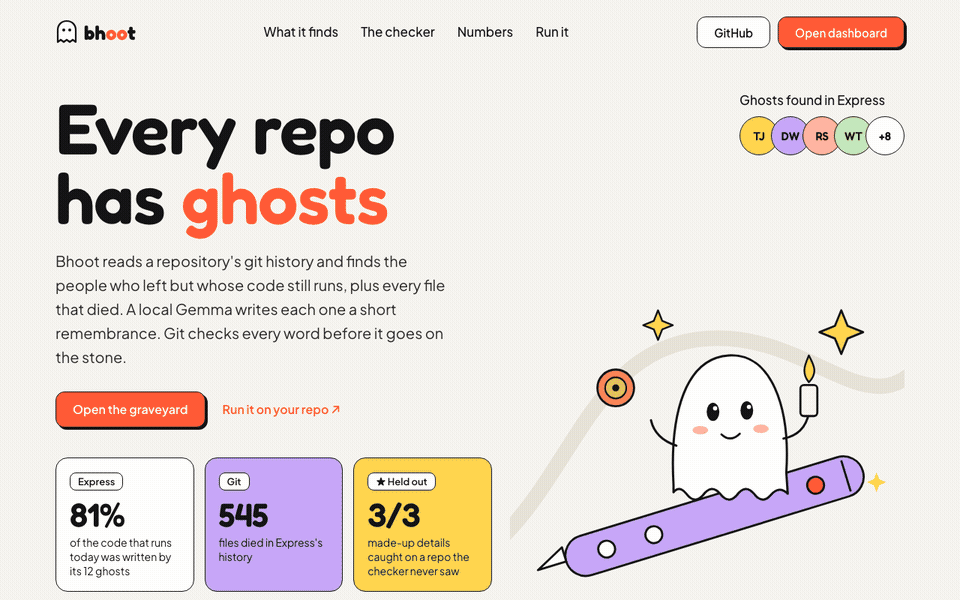
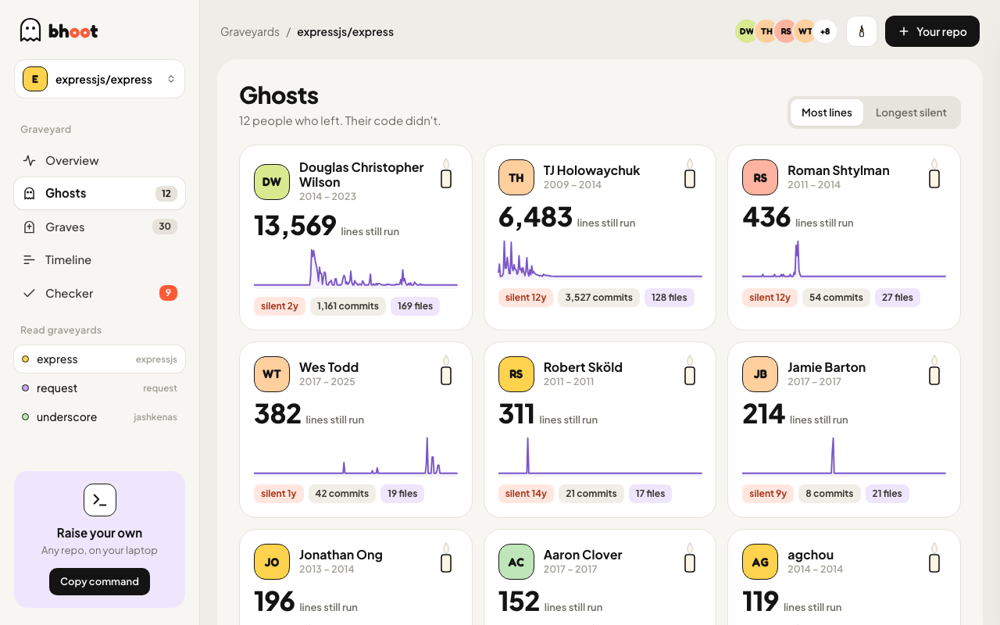
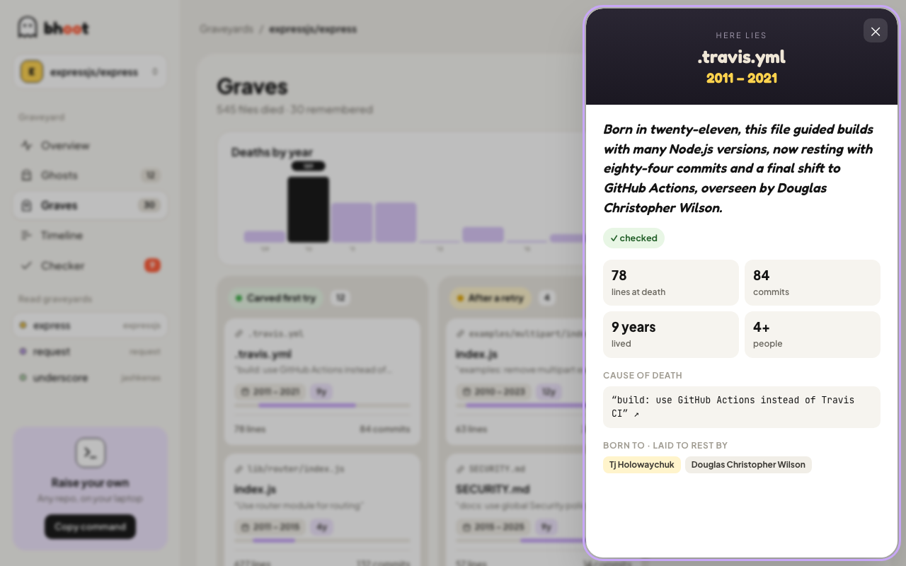

<div align="center">


# Bhoot · भूत

**In Hindi, *bhoot* means ghost. It also means the past.**<br>
Bhoot reads your repository's git history, finds both, and writes them a remembrance that git can vouch for.

[](https://bhoot-graveyard.vercel.app)
[](https://ollama.com/library/gemma3)
[](#faq)
[](test/checker.test.ts)
[](package.json)
[](LICENSE)

[**Walk a graveyard**](https://bhoot-graveyard.vercel.app/app?repo=express) · [Quick start](#quick-start) · [How it works](#how-it-works) · [Numbers](#numbers) · [FAQ](#faq)



</div>

---

TJ Holowaychuk hasn't committed to Express since February 2014. **6,483 of his lines still run.**

Every old repository has ghosts like that: people who moved on but whose code didn't. It also has graves: files that were born, argued over for a few hundred commits, and deleted, with the reason buried in a commit message. Bhoot finds both on your own laptop. A local Gemma writes each a short remembrance in the spirit of Día de los Muertos, and code checks every name, number, date and file in it against git before it's carved.

## Contents

- [Features](#features)
- [The graveyards](#the-graveyards)
- [Quick start](#quick-start)
- [How it works](#how-it-works)
- [Numbers](#numbers)
- [Screenshots](#screenshots)
- [Project structure](#project-structure)
- [FAQ](#faq)
- [Limitations](#limitations)
- [Credits](#credits)

## Features

- 👻 **Still haunting.** Everyone who's been silent for a year or more, ranked by how many of their lines `git blame` still finds at HEAD, with their oldest surviving line.
- 🪦 **The departed.** Every deleted file gets a tombstone: born, died, who wrote it, who removed it, how long it lived, and its **cause of death**, which is the subject of the commit that deleted it. Renames don't count as deaths.
- 🌼 **Remembrances by a local Gemma.** Two sentences each: warm, a little eerie, never mocking.
- ✅ **A checker that reads what numbers count.** "6,483 lines" passes. "3,527 silent years" fails, because 3,527 is a commit count. Years must match the right event, and names must match the right role.
- 🔁 **One retry, then plain facts.** Gemma is told what it got wrong. If it fails twice, the stone carries plain dates instead. Every stone's badge says which happened.
- 🧑‍🤝‍🧑 **One person, many spellings.** `TJ Holowaychuk`, `Tj Holowaychuk` and `visionmedia` are merged into one ghost by a union-find over names and emails.
- 🏡 **Family plots.** Files deleted by the same commit share one stone, with the siblings listed underneath.
- 🕯️ **Light a candle.** It stays lit in your browser.
- 🔒 **Nothing leaves your machine.** Git does the reading, Ollama runs the model, and the output is one HTML file.

## The graveyards

| Repository | What you'll find |
|---|---|
| [**expressjs/express**](https://bhoot-graveyard.vercel.app/app?repo=express) | 12 ghosts and 30 graves from 6,183 commits. TJ Holowaychuk's 6,483 lines still run. |
| [**request/request**](https://bhoot-graveyard.vercel.app/app?repo=request) | The HTTP library half of npm leaned on. Its last commit, in 2020, fixed a typo in its own deprecation notice. |
| [**jashkenas/underscore**](https://bhoot-graveyard.vercel.app/app?repo=underscore) | Born 2009. Jeremy Ashkenas's oldest surviving line is a 2009 test fixture: `var list = [1, [2], [3, [[[4]]]]];` |

## Quick start

```bash
ollama pull gemma3:4b
git clone https://github.com/codeswithroh/bhoot && cd bhoot
node src/cli.ts /path/to/your/repo --out graveyard
open graveyard/index.html
```

Needs [Node 22.18+](https://nodejs.org) (TypeScript runs natively, with no build step and no dependencies) and [Ollama](https://ollama.com).

| Option | Default | What it does |
|---|---|---|
| `--out <dir>` | `site` | Where the graveyard is written (`index.html`, `graveyard.json`, `remembrances.json`) |
| `--ghosts <n>` | `12` | How many ghosts to remember |
| `--graves <n>` | `30` | How many deleted files to remember |
| `--quiet-years <n>` | `1` | How long someone must be silent to count as a ghost |
| `--min-lines <n>` | `50` | How many of their lines must still be at HEAD |
| `BHOOT_MODEL` | `gemma3:4b` | Any Ollama model, e.g. `gemma3:12b` |

Remembrances are cached, so a second run on the same repo is instant. Delete `remembrances.json` to write them again.

## How it works

```
git log / blame / show ──► facts: who, when, how many, what the code said
                               │
                 Gemma ◄───────┘  "write a remembrance using only these facts"
                   │
                   ▼
              the checker ──► every number must count what the facts say it counts
                              every year must belong to the right event (born vs died)
                              every "written by X" / "removed by Y" must match git
                              every name, month, quote, file and identifier must be in the facts
                   │
        pass ──► carved      fail ──► one retry, told what it got wrong
                                       fail again ──► the stone carries plain dates instead
```

The checker exists because of what Gemma actually wrote. On the first Express run it called TJ Holowaychuk's **3,527 commits** "3,527 silent years", and a contributing guide's **32 commits** "32 contributors". Every number was real. They were attached to the wrong things. `test/checker.test.ts` keeps those cases caught, alongside three bugs in the checker itself: it once thought **July was a person**, read **"eighty-four commits" as "four commits"**, and treated **"Chambers'"** as a stranger.

## Numbers

Every first attempt Gemma made was labelled by hand: true, or saying something git contradicts (including a real number attached to the wrong thing). The labels are in [`eval/labels.json`](eval/labels.json), and this re-scores the checker on them:

```bash
node eval/score.ts eval/express-v1.json eval/request-v1.json eval/underscore-heldout.json
```

| | Gemma's first attempts that were false | Caught by the checker | True attempts wrongly rejected |
|---|---|---|---|
| express + request (checker tuned on these) | 22 / 78 | 22 / 22 | 0 / 56 |
| **underscore, held out** (checker frozen at `e2f3d9a` before it ran) | **3 / 16** | **3 / 3** | **1 / 13** |

On the held-out repo every carved stone was true. The one false alarm was the possessive-apostrophe bug; Gemma's retry passed, and the bug was fixed after the run. Sixteen stones is a small held-out set and there's one labeller, so everything needed to disagree is in [`eval/`](eval).

## Screenshots

<table>
<tr>
<td width="50%"></td>
<td width="50%"></td>
</tr>
<tr>
<td align="center"><b>Still haunting</b>: lines that outlived their authors' commits</td>
<td align="center"><b>The departed</b>: born, died, and why</td>
</tr>
</table>

## Project structure

```
src/
  cli.ts        picks the ghosts and graves, asks Gemma, writes the site
  git.ts        everything Bhoot knows: log, blame, deletions, identity merging
  remember.ts   the facts, the prompt, and the checker
  ollama.ts     the local model client (patient, retries a dropped call)
  render.ts     the graveyard page: one self-contained HTML file
test/
  checker.test.ts   every case Gemma (or the checker) actually got wrong
eval/
  labels.json       hand labels for every first attempt
  score.ts          re-scores the checker against those labels
  *.json            the saved runs those labels refer to
site/               the published graveyards
```

## FAQ

<details>
<summary><b>Does my code or history leave my machine?</b></summary>

No. Git reads the history locally, Gemma runs in Ollama on the same machine, and the result is a static HTML file. There's no account, API key or network call to any model service.
</details>

<details>
<summary><b>Who counts as a ghost?</b></summary>

Anyone whose last commit is at least `--quiet-years` before the repo's latest commit, and who still has at least `--min-lines` lines at HEAD according to `git blame -w`. Lockfiles, build output, vendored code and binaries are skipped.
</details>

<details>
<summary><b>Isn't "silent" unkind? People leave projects for good reasons.</b></summary>

That's why the prompt says "never mocking", and why the page is framed as Día de los Muertos: remembering people by name, with the details right. It's a thank-you note that git can verify.
</details>

<details>
<summary><b>Why Gemma 3 4B and not something bigger?</b></summary>

It runs on an 8 GB laptop, and the checker matters more than the model. A bigger model (`BHOOT_MODEL=gemma3:12b`) should make fewer "3,527 silent years" mistakes, and the checker catches the ones it still makes.
</details>

<details>
<summary><b>Why does the same repo give the same remembrances?</b></summary>

The seed is fixed. That's what made the evaluation honest: after changing the checker, it could be re-run on exactly the same attempts Gemma had already written.
</details>

## Limitations

- The checker understands English prose about counts, years and roles. It can't judge whether "a quiet guardian" is a fair description, only whether the facts in the sentence are true.
- `git blame` credits the last person to touch a line, so a big reformat can turn someone into a ghost early, or hide one.
- Identity merging joins names and emails that ever appeared together. Shared bot or placeholder emails are ignored so strangers aren't merged, but an unusual history can still fool it.
- Very large repositories take a while to blame. It's slow but steady, and it only runs once per repo.

## Credits

- [Gemma 3](https://ai.google.dev/gemma) via [Ollama](https://ollama.com). Gemma is provided under the [Gemma Terms of Use](https://ai.google.dev/gemma/terms).
- The graveyards are built from the public histories of [expressjs/express](https://github.com/expressjs/express), [request/request](https://github.com/request/request) and [jashkenas/underscore](https://github.com/jashkenas/underscore). Thank you to everyone in them.
- Fonts: Cormorant Garamond, Inter, JetBrains Mono and Tiro Devanagari Hindi, via Google Fonts.

MIT licensed. See [LICENSE](LICENSE).
