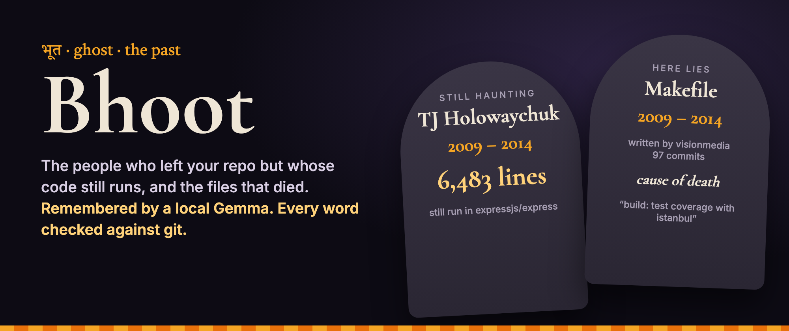

# Bhoot (भूत)



In Hindi, *bhoot* means ghost. It also means the past.

Bhoot reads a repository's git history on your own laptop and finds both:

- **Ghosts**: people who stopped committing long ago, but whose lines still run today (from `git blame` at HEAD)
- **The departed**: files that were born, changed and deleted, each with a tombstone, and a "cause of death" taken from the commit that removed them

A local Gemma writes each of them a two-sentence remembrance, in the spirit of Día de los Muertos. Then code checks every name, number, date and file in those words against git, and throws away anything Gemma made up.

**Graveyards:** [expressjs/express](https://bhoot-graveyard.vercel.app/express) · [request/request](https://bhoot-graveyard.vercel.app/request) · [jashkenas/underscore](https://bhoot-graveyard.vercel.app/underscore)

## Run it on your repo

```bash
ollama pull gemma3:4b
node src/cli.ts /path/to/repo --out graveyard     # Node 22.6+
open graveyard/index.html
```

Options: `--ghosts 12`, `--graves 30`, `--quiet-years 1` (how long someone must be silent to count as a ghost), `--min-lines 50`. `BHOOT_MODEL=gemma3:12b` uses a bigger Gemma.

Nothing leaves your machine. Git does the reading, Gemma runs in Ollama, and the output is one HTML file plus the JSON it was built from.

## How it stays honest

```
git log / blame / show ──► facts (who, when, how many, what the code said)
                               │
                 Gemma ◄───────┘  "write a remembrance using only these facts"
                   │
                   ▼
              the checker ──► every number must count what the facts say it counts
                              every year must belong to the right event (born vs died)
                              every "written by X" / "removed by Y" must match git
                              every name, month, quote, file and identifier must be in the facts
                   │
        pass ──► carved      fail ──► one retry, told what it got wrong
                                       fail again ──► the stone carries plain dates instead
```

The checker exists because of what Gemma actually wrote. On the first Express run it described TJ Holowaychuk's **3,527 commits** as "3,527 silent years", and a contributing guide's **32 commits** as "32 contributors". Every number was real. They were attached to the wrong things. `test/checker.test.ts` keeps those cases caught.

## Numbers

I labelled every first attempt Gemma made by hand: true, or saying something git contradicts (including a real number attached to the wrong thing). Labels are in `eval/labels.json`; `node eval/score.ts eval/*-v1.json eval/underscore-heldout.json` re-scores the checker on them.

| | Gemma's first attempts that were false | Caught by the checker | True attempts wrongly rejected |
|---|---|---|---|
| express + request (the checker was tuned on these) | 22 / 78 | 22 / 22 | 0 / 56 |
| **underscore (held out: checker frozen at `e2f3d9a` before it ran)** | **3 / 16** | **3 / 3** | **1 / 13** |

The one false alarm on the held-out repo was a bug: "David Chambers' code" was rejected because the possessive apostrophe wasn't stripped before the name lookup. Gemma's retry was true, so nothing wrong was carved, and the bug is fixed (with a test) after the run.

The most common invention wasn't a made-up number. It was a real one, attached to the wrong thing: commits counted as "silent years" (TJ Holowaychuk's 3,527, Graeme Yeates's 145, Brad Dunbar's 127), as "contributors", as "tests", as "brief lives".

## Credits

Gemma 3 4B via [Ollama](https://ollama.com). Gemma is provided under the [Gemma Terms of Use](https://ai.google.dev/gemma/terms). MIT licensed.
